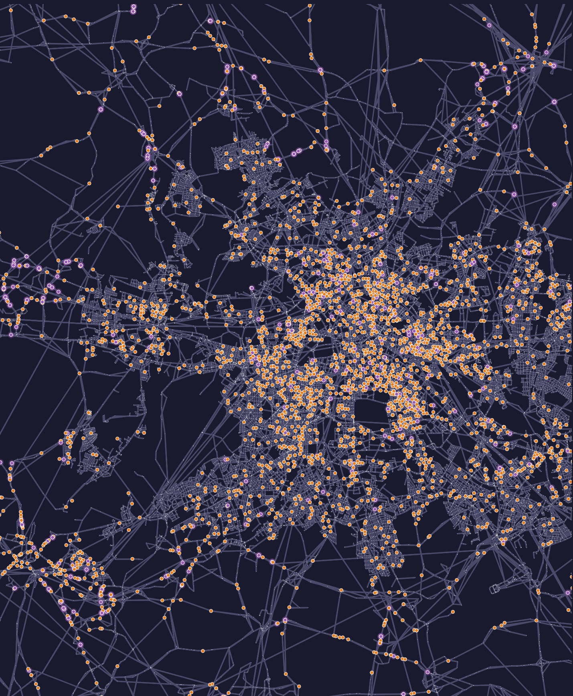
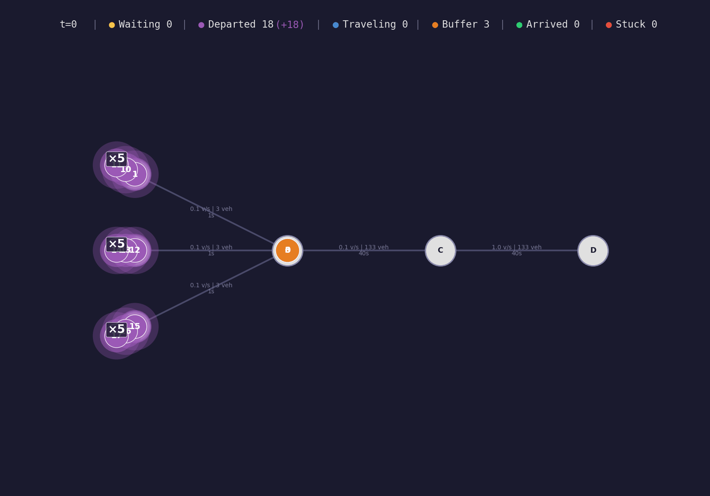

# TrafficGym 🚦


**TrafficGym** is a GPU-accelerated Dynamic Traffic Assignment (DTA) environment and benchmark for massively multi-agent routing games. Route a million learning vehicles through a real city and watch equilibrium emerge — on a single GPU, in minutes instead of days.

At its core is **TorchDNL**, a vectorized Dynamic Network Loading engine implemented entirely in PyTorch tensor ops — no Python-level per-agent loop anywhere in the simulation step. RL agents choose routes; TorchDNL simulates the resulting queueing, spillback, and flow-capacity dynamics and returns travel times as rewards. It scales to metropolitan-scale networks (Berlin, Los Angeles, ...) and populations exceeding $10^6$ concurrently learning agents.

<p align="center">
  
</p>

<p align="center">
  <br>
  <em>A shockwave forming at a capacity bottleneck in a toy corridor network.</em>
</p>


## Table of Contents

- [Why TrafficGym](#why-trafficgym)
- [Installation](#installation)
- [Quick Start](#quick-start)
- [Architecture](#architecture)
- [Formulations & Agents](#formulations--agents)
- [Running Your Own Experiments](#running-your-own-experiments)
- [Using Your Own Scenarios](#using-your-own-scenarios)
- [Writing Your Own Agent](#writing-your-own-agent)
- [Using TrafficGym as a Library](#using-trafficgym-as-a-library)
- [Results and Reproducibility](#-results-and-reproducibility)
- [Tests and Benchmarks](#tests-and-benchmarks)
- [Repository Layout](#repository-layout)
- [License](#license)
- [Citation](#citation)

## ✨ Why TrafficGym

- **Blazing fast simulation.** TorchDNL computes traffic dynamics directly on the GPU with vectorized tensor operations, sidestepping the per-agent-loop overhead of traditional CPU simulators (MATSim, SUMO) — see the throughput comparison in the paper.
- **CSR everywhere, not dense padding.** Paths, routes, and per-agent activity chains are stored in compressed sparse row format, not `[Agents, MaxLen]` dense tensors — this is what makes million-agent, city-scale scenarios fit in GPU memory at all.
- **Gymnasium & PettingZoo compatible.** Standard `reset`/`step` wrappers slot into existing RL codebases with no glue code.
- **Multiple formulations out of the box.** One-shot bandit route choice (Agent-level, OD-level, Centralized) or sequential POMDP decision-making for step-by-step MARL (IPPO/MAPPO) — same underlying simulator, different learning-signal aggregation.
- **Research-ready.** Nine bandit algorithms, benchmarking/profiling scripts, MATSim/SUMO fidelity validation harnesses, and a dozen scenarios from synthetic toy networks to real metropolitan populations (Berlin, Los Angeles, Leipzig, ...).
- **Built-in visualization.** Render any simulation to an animated GIF/MP4 straight from the CLI.

## 🚀 Installation

TrafficGym requires **Python 3.10+** and (optionally, but strongly recommended for anything beyond toy scenarios) a CUDA-capable GPU.

```bash
# 1. Clone the repository
git clone https://github.com/anonymous/TrafficGym.git
cd TrafficGym

# 2. Create an environment (conda shown, venv works identically)
conda create -n trafficgym python=3.10
conda activate trafficgym

# 3. Install the package in editable mode (pulls in pytest + ruff dev extras)
pip install -e .
```

<details>
<summary><strong>Optional extras</strong></summary>

```bash
# Geo-visualisation scripts (geopandas/shapely) — only needed for map-based rendering
pip install -e ".[geo]"
```

</details>

Sanity-check the install with the fast benchmark scenario:

```bash
PYTHONPATH=. python tests/benchmark_torchdnl.py tamarl/data/scenarios/grid_world/3x3 --population 100
```

## 🏁 Quick Start

Train a UCB bandit on a tiny synthetic grid in under a minute:

```bash
python -m tamarl.rl.train_bandit --scenario tamarl/data/scenarios/grid_world/3x3 --population 100 --agent ucb
```

That's the whole loop: load a scenario → build top-k candidate routes per OD pair → run episodes of `pick route → simulate → -travel_time as reward → update` → print per-episode mean travel time / regret.

Swap in a real city once you're ready to scale up — see [Running Your Own Experiments](#-running-your-own-experiments) and [Using Your Own Scenarios](#️-using-your-own-scenarios) below.

## 🏗️ Architecture

```
tamarl/core/torchdnl.py          TorchDNL — the simulation engine (no RL/gym awareness)
tamarl/envs/dta_bandit_env.py    DTABanditEnv — thin orchestrator: reset(paths) → step() → rewards
tamarl/envs/*_wrapper.py         Gym/PettingZoo-facing formulations (Agent/OD/Centralized/POMDP)
tamarl/envs/components/          Route enumeration (Yen/Sidetrack/Penalty), CSR route utilities
tamarl/rl/                       Training loops + bandit-style RL agents
tamarl/data/scenarios/           MATSim-style network + population data, real and synthetic
scripts/                         CLI entry points: fetch data, profile, scale, regenerate figures
```

**TorchDNL** is a Structure-of-Arrays simulator: every agent-state field (`status`, `current_edge`, `wakeup_time`, ...) is a flat tensor indexed by agent id, and every operation is a vectorized tensor op over *all* agents/edges at once. Each `step()` runs three phases, mirroring the MATSim DNL queue model:

1. **`_process_nodes_A`** — capacity buffer → downstream spatial buffer, gated by storage capacity and randomized per-link merge priority.
2. **`_process_links_B`** — spatial buffer → capacity buffer, gated by flow capacity and FIFO link ordering; also detects network exits.
3. **`_schedule_demand_C`** — dispatches agents whose departure/activity time has arrived, and advances multi-leg agents into their next activity.

**DTABanditEnv** knows nothing about RL — it just runs the simulation to completion and returns `-travel_time`. The **formulation wrappers** (`AgentLevelWrapper`, `ODLevelWrapper`, `CentralizedLevelWrapper`, `POMDPWrapper`) sit on top and decide how learning signal is aggregated across vehicles via an `aggregation_indices` tensor — this is what lets the same bandit agent implementation be reused unchanged across formulations (see [Formulations & Agents](#-formulations--agents)).

A full component-by-component deep dive (status codes, multi-leg activity chains, instrumentation buffers, config resolution order, etc.) lives in [CLAUDE.md](CLAUDE.md) — written for AI coding assistants, but equally useful as a technical reference for humans hacking on the engine.

## 🎯 Formulations & Agents

| Formulation | Action granularity | Parameter sharing |
|---|---|---|
| `agent` (`AgentLevelWrapper`) | One decision per vehicle-leg | None — every leg learns independently |
| `od_pair` (`ODLevelWrapper`) | One decision per vehicle-leg | Shared per origin-destination pair |
| `centralized` (`CentralizedLevelWrapper`) | One decision per vehicle-leg | Fully shared, single parameter block |
| POMDP (`POMDPWrapper`, via `scripts/train_marl.py`) | Sequential, one decision per departure event | Per-agent policy network (IPPO/MAPPO) |

All formulations pick among the top-*k* precomputed candidate routes for a vehicle's OD pair (`--top_k_paths`, `--path_method {yen,sidetrack,penalty}`).

| Agent (`--agent`) | Algorithm |
|---|---|
| `random` | Uniform random baseline |
| `epsilon_greedy` | ε-greedy with decaying ε |
| `ucb` | Upper Confidence Bound |
| `ts` | Thompson Sampling |
| `exp3` | Adversarial bandit (Exp3) |
| `msa` | Method of Successive Averages (Frank-Wolfe-style DTA solver) |
| `aon` / `frank_wolfe` | All-or-Nothing / Frank-Wolfe assignment |
| `evo_swap` | Evolutionary route-swap dynamics |
| `rd` | Replicator Dynamics |

## 🔬 Running Your Own Experiments

Every experiment goes through `tamarl.rl.train_bandit` (one-shot bandit formulations) or `scripts/train_marl.py` (sequential POMDP / deep MARL). Config resolution order for `train_bandit`: built-in defaults → JSON `--config` file → explicit CLI flags (CLI always wins), so you can start from a config and override just what you need.

```bash
# Start from a config, override the agent and seed from the CLI
python -m tamarl.rl.train_bandit --config tamarl/data/configs/config_SF.json --agent ucb --seed 0

# ...or skip the config entirely and pass everything as flags
python -m tamarl.rl.train_bandit \
  --scenario tamarl/data/scenarios/grid_world/8x8 --population 5000 \
  --agent ts --formulation od_pair --top_k_paths 9 \
  --episodes 200 --max_steps 86400 --device cuda --seed 0
```

<details>
<summary><strong>Full CLI flag reference</strong> (<code>python -m tamarl.rl.train_bandit --help</code> for the authoritative list)</summary>

| Flag | Meaning |
|---|---|
| `--scenario PATH` | Path to a scenario folder (network + population XML) |
| `--population FILTER` | Substring/token filter to select a population file (e.g. `100`, `5pct`, `1pct`) |
| `--agent {random,epsilon_greedy,ucb,aon,frank_wolfe,ts,exp3,msa,evo_swap,rd}` | Routing policy to train |
| `--formulation {agent,od_pair,centralized}` | How learning signal is aggregated across vehicles |
| `--bandit_feedback {full,semi}` | Full information vs. semi-bandit feedback |
| `--top_k_paths N` | Size of the candidate-route action space per OD pair (default: 3) |
| `--path_method {yen,sidetrack,penalty}` | Candidate-route enumeration algorithm (default: penalty) |
| `--reload_paths` | Force recomputation of the cached top-k candidate routes |
| `--episodes N` / `--max_steps N` | Training horizon (episodes) and per-episode simulation horizon (seconds) |
| `--timestep S` | Simulation timestep in seconds |
| `--scale_factor F` | Network capacity scale factor |
| `--stuck_threshold N` | Steps before a stuck agent is force-advanced |
| `--device {cpu,cuda}` / `--seed N` | Device and random seed |
| `--wandb` / `--wandb_project` | Enable Weights & Biases logging |
| `--render {interval,end}` / `--render_format {gif,mp4,live}` | Render episodes to GIF/MP4/live view |
| `--sanity_checks` | Emit FFTT scatter / V-C histogram / regret violin plots at the end of training |
| `--log_interval N` | Log metrics every N episodes |

Every per-algorithm hyperparameter is also overridable from the CLI: `--ucb_c`, `--epsilon_start`/`--epsilon_end`/`--epsilon_decay`, `--exp3_eta`/`--exp3_gamma`, `--rd_beta`, `--ts_prior_std`/`--ts_env_std`, and more — run `--help` for the exhaustive, always-up-to-date list.

</details>

**JSON configs** (`tamarl/data/configs/*.json`, schema documented in `default_config.json`) are the recommended way to save and share a full experiment setup:

```bash
python -m tamarl.rl.train_bandit --config tamarl/data/configs/config_Leipzig.json --agent msa
```

**Weights & Biases logging**: pass `--wandb --wandb_project my-project` to stream per-episode metrics (mean travel time, regret, entropy) to W&B instead of stdout.

**Sequential / deep MARL training** (IPPO/MAPPO over the POMDP formulation):

```bash
python scripts/train_marl.py --scenario tamarl/data/scenarios/sioux_falls --algo mappo
```

**Sweeping hyperparameters**: `scripts/run_ablation_sweep.py` runs `train_bandit` across a grid of hyperparameter values and seeds, writing merged CSVs you can plot with `tamarl/visualisation/ablation_figures.py` — the pattern used to produce every ablation figure in the paper.

## 🗺️ Using Your Own Scenarios

A scenario is just a folder containing a MATSim-style `network.xml` and one or more `*_population.xml` files. TrafficGym never depends on MATSim itself — `tamarl/envs/scenario_loader.py` parses the XML directly into the tensors `TorchDNL` needs.

### Option A — bring your own MATSim network

Point `--scenario` at any folder with that layout:

```
my_scenario/
├── network.xml            # nodes + links (see minimal example below)
├── 100_population.xml     # one population file per demand level; select with --population 100
└── 500_population.xml
```

<details>
<summary><strong>Minimal <code>network.xml</code> / <code>population.xml</code> example</strong></summary>

```xml
<!-- network.xml -->
<?xml version="1.0" encoding="utf-8"?>
<network name="toy network">
   <nodes>
      <node id="0" x="0" y="0"/>
      <node id="1" x="1000" y="0"/>
      <node id="2" x="2000" y="0"/>
   </nodes>
   <links>
      <link id="0-1" from="0" to="1" length="1000.00" capacity="1800" freespeed="13.89" permlanes="1" modes="car"/>
      <link id="1-2" from="1" to="2" length="1000.00" capacity="1800" freespeed="13.89" permlanes="1" modes="car"/>
   </links>
</network>
```

```xml
<!-- 1_population.xml -->
<?xml version="1.0" encoding="utf-8"?>
<population>
    <person id="agent_000">
        <plan selected="yes">
            <act type="h" link="0-1" end_time="08:00:00"/>
            <leg mode="car">
                <route type="links" start_link="0-1" end_link="1-2">0-1 1-2</route>
            </leg>
            <act type="w" link="1-2" end_time="17:00:00"/>
        </plan>
    </person>
</population>
```

Only `mode="car"` links/legs are consumed at parse time — everything else is filtered out automatically, so raw MATSim scenario dumps load as-is with no cleanup pass required. Multi-activity plans (more than one `<act>`/`<leg>` pair) are supported natively; each additional leg becomes part of the same agent's activity chain.

</details>

Once the folder is in place, train against it exactly like any shipped scenario:

```bash
python -m tamarl.rl.train_bandit --scenario path/to/my_scenario --population 100 --agent ucb
```

The first run computes and caches the top-*k* candidate routes per OD pair to disk next to the scenario; pass `--reload_paths` after editing the network to force recomputation.

### Option B — generate a synthetic grid

For controlled scaling experiments (varying network size / population independently), regenerate a Manhattan-style grid of any dimension:

```bash
python tamarl/data/scenarios/grid_world/generate_grid_scenario.py --size 16 --agents 20000 --prefix grid16
```

Key flags: `--size N` (an `N x N` node grid), `--agents N`, `--capacity`, `--freespeed`, `--seed`. See `generate_grid_scenario_uniqueOD.py` / `generate_random_grid_scenario.py` for OD-pattern variants, and `tamarl/data/scenarios/braess/generate_braess.py` for parametric Braess-paradox networks.

### Option C — fetch a real MATSim open-scenario

Berlin, Los Angeles, Leipzig, and several other real metropolitan scenarios aren't shipped in the repo (tens of GB) but are one command away:

```bash
python scripts/fetch_scenario_data.py --list                    # see everything available
python scripts/fetch_scenario_data.py --scenario leipzig        # fetch one
```

See [DATA.md](DATA.md) for the full scenario table with sources, licenses, and population-fraction options — every real-world scenario is consumed as-is from public MATSim repositories, never modified or re-synthesized.

## 🧠 Writing Your Own Agent

Every bandit agent in `tamarl/rl/agents/` implements the same two-method interface, vectorized over *all* decision-makers at once (no per-agent Python loop):

```python
class MyAgent:
    def __init__(self, num_models: int, k_paths: int, device: str = "cpu"):
        ...  # allocate [B, K] parameter tensors, B = num_models, K = k_paths

    def get_actions_batched(self, obs, masks, aggregation_indices=None, **kwargs) -> torch.Tensor:
        """masks: [N, K] valid-route mask. aggregation_indices: [N] vehicle → parameter-block
        mapping. Returns actions: [N] long tensor."""
        ...

    def update(self, actions, rewards, aggregation_indices=None, **kwargs) -> None:
        """valid_mask (in kwargs) marks legs that actually departed within max_steps —
        multi-leg agents whose earlier leg didn't finish in time must be excluded, not
        just zero-rewarded, or they'll corrupt per-block statistics."""
        ...
```

Because agents always index into their own `[B, K]` tensors through `aggregation_indices` rather than assuming one parameter block per vehicle, the *same* agent class works unmodified across the `agent`/`od_pair`/`centralized` formulations — the wrapper decides what `B` means, the agent never needs to know. `tamarl/rl/agents/ucb_agent.py` is the shortest reference implementation to copy from.

To wire a new agent into the CLI, add an `elif agent_type == "my_agent":` branch next to the others around `tamarl/rl/train_bandit.py:473` and add `"my_agent"` to the `--agent` `choices=[...]` list near the top of the same file.

## 🐍 Using TrafficGym as a Library

For programmatic use (e.g. embedding TrafficGym in another RL codebase), the lower-level Gymnasium-style API is available directly, without going through the CLI trainer:

```python
import torch
from tamarl.envs.dta_bandit_env import DTABanditEnv
from tamarl.envs.agent_level_wrapper import AgentLevelWrapper

device = "cuda" if torch.cuda.is_available() else "cpu"

# 1. Instantiate the base bandit environment
bandit = DTABanditEnv(
    scenario_path="tamarl/data/scenarios/grid_world/3x3",
    population_filter="100",
    device=device,
)

# 2. Wrap it for RL (Agent-level formulation)
env = AgentLevelWrapper(bandit=bandit, top_k=3)

# 3. Standard RL loop
obs, info = env.reset()
done = False

while not done:
    actions = {agent_id: env.action_space(agent_id).sample() for agent_id in env.agents}
    obs, rewards, terminations, truncations, infos = env.step(actions)
    done = all(terminations.values()) or all(truncations.values())

print("Simulation complete! ✅")
```

## 📖 Results and Reproducibility

**[RESULTS.md](RESULTS.md)** holds every measured number: the wall-clock scaling
tables against MATSim and SUMO, the DNL-fidelity validation against MATSim, and the
memory ceilings. Nothing in it is extrapolated, and it is generated rather than
written — the CSVs it reads from are committed under
**[results/](results/README.md)**, which maps each file to the claim it backs.

The cheapest way to check that: no GPU, no cluster account, no scenario download.

```bash
./scripts/regenerate_results.sh && git diff --exit-code RESULTS.md
```

An empty diff means every number in RESULTS.md traces to a CSV in this repository.

**[REPRODUCIBILITY.md](REPRODUCIBILITY.md)** documents the hardware and software,
the per-scenario commands, the hyperparameters, the Slurm scripts for each campaign
and the environment variables they need — plus two places where the committed JSON
configs have drifted from the configuration the reported campaign actually ran, and
one known defect in the reported MSA and RD curves.

## 🧪 Tests and Benchmarks

```bash
# Full test suite
pytest
pytest tests/test_torchdnl.py::test_spillback   # a single test

# Lint / format
ruff check .
ruff format .

# Benchmark the core DNL engine (use this exact scenario for perf comparisons — it runs fast)
PYTHONPATH=. python tests/benchmark_torchdnl.py tamarl/data/scenarios/grid_world/3x3 --population 100
```

`tests/` also contains standalone benchmarking/profiling scripts (`benchmark_torchdnl.py`, `profile_dnl_workload_compare.py`, `compare_paths.py`) that aren't pytest tests despite living in the same directory — run them directly with `python`.

### Regenerating the demo GIF

```bash
./scripts/generate_demo_gif.sh
```

## 📁 Repository Layout

```
tamarl/
├── core/torchdnl.py            TorchDNL simulation engine
├── envs/                       DTABanditEnv + Gym/PettingZoo formulation wrappers
│   └── components/             Route enumeration, CSR route utilities, time-dependent evaluator
├── rl/
│   ├── train_bandit.py         Primary trainer (one-shot bandit formulations)
│   └── agents/                 UCB, Thompson Sampling, Exp3, MSA, Replicator Dynamics, ...
├── data/
│   ├── scenarios/               Network + population data, real and synthetic
│   └── configs/                 JSON experiment configs
└── visualisation/               Rendering + figure-generation utilities

results/                         Measured results as CSV, one file per experiment cell
docs/                            Provenance notes that RESULTS.md is generated from
scripts/                         CLI tools: fetch data, profile, scale networks, run campaigns, regenerate figures
tests/                           pytest suite + standalone benchmark/profiling scripts
```

## 📄 License

This project is licensed under the MIT License — see the [LICENSE](LICENSE) file for details.

Real-world scenario data is fetched on demand from public MATSim repositories under their own licenses (mostly CC-BY 4.0; one exception noted) — see [DATA.md](DATA.md) for the exact terms per scenario.

## 📚 Citation

If you use TrafficGym in your research, please cite our paper:

```bibtex
@inproceedings{anonymous2027trafficgym,
  title={TrafficGym: A GPU-Accelerated Simulator and Benchmark for Massively Multi-Agent Routing Games},
  author={Anonymous Authors},
  booktitle={Under Double-Blind Review},
  year={2027}
}
```
